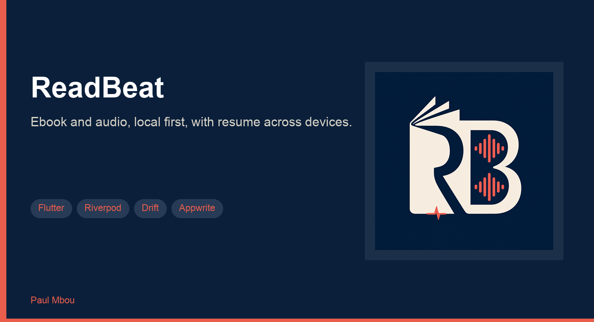

# ReadBeat

**Local-first ebook and audiobook app, with resume across devices.**
Lecture et audio hors ligne d’abord : la reprise reprend au bon endroit, même après un changement d’appareil.




## What it does

- Library of ebooks and audio, with search, favorites and playlists
- Reader and audio player, progress stored on the device
- Sync of progress and files through Appwrite (Auth, Database, Storage)
- On-device import, then a cloud copy when the account is signed in
- A short recap flow on top of a title the person has opened

## Stack

| | |
|---|---|
| App | Flutter, Riverpod |
| Local data | Drift (SQLite) |
| Account and files | Appwrite |
| Platforms | iOS, Android |

## Run

The Appwrite endpoint and project id are in `lib/core/config/environment.dart`. Replace them with your own project before running.

```bash
flutter pub get
dart run build_runner build --delete-conflicting-outputs
flutter run
```

```bash
flutter test
```

## Author

Paul Mbou — [github.com/paul-mbou](https://github.com/paul-mbou)
